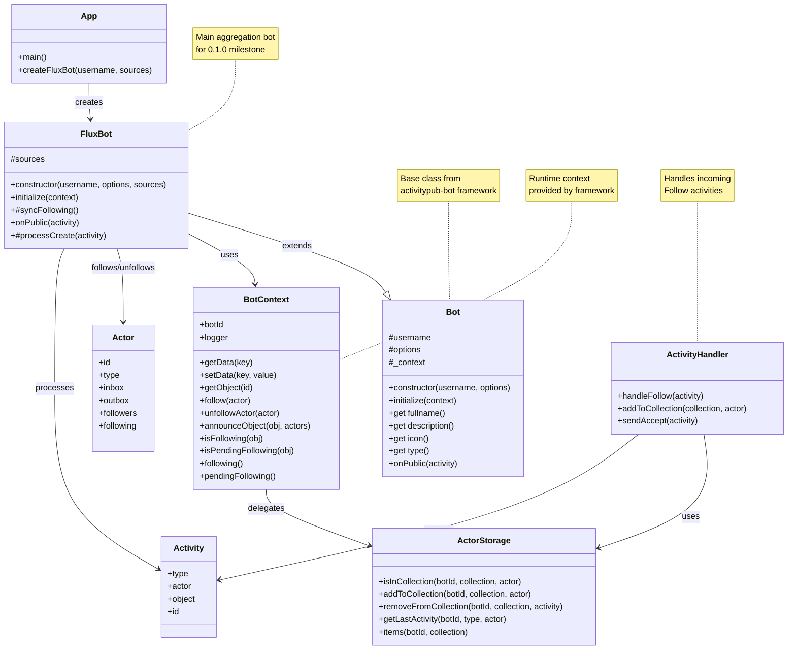

# Class Diagram

This document shows the class structure of flux.pub, focusing on the classes and methods involved in the 0.1.0 milestone.

## Class Descriptions

### App
**Responsibility**: Application entry point that creates and configures FluxBot instances.

**Key Methods**:
- `main()` - Initialize the application and create bots
- `createFluxBot(username, sources)` - Factory method to instantiate FluxBot with sources array

### Bot (from activitypub-bot)
**Responsibility**: Base class providing core ActivityPub bot functionality.

**Key Methods**:
- `initialize(context)` - Set up bot with runtime context
- `onFollow(actor, activity)` - Handle incoming Follow activities (default: accept)
- `onPublic(activity)` - Handle public activities (default: no-op)
- `onAnnounce(object, activity)` - Handle incoming Announce activities
- `handleActivity(activity)` - Pre-processing hook for activities

### FluxBot
**Responsibility**: Aggregation bot that follows source actors and announces their content.

**Key Methods**:
- `constructor(username, options, sources)` - Initialize with sources array
- `initialize(context)` - Call parent initialize, then sync following
- `syncFollowing()` - Synchronize following collection with sources
- `onPublic(activity)` - Intercept public activities, announce if from followed actor
- `processCreate(activity)` - Handle Create activities from followed actors

### BotContext (from activitypub-bot)
**Responsibility**: Runtime context providing access to storage, client operations, and bot state.

**Key Methods**:
- `getData(key)` / `setData(key, value)` - Persistent key-value storage
- `getObject(id)` - Fetch ActivityPub objects
- `follow(actor)` - Send Follow activity, track in pendingFollowing
- `unfollowActor(actor)` - Send Undo(Follow), remove from collections
- `announceObject(obj, actors)` - Create and distribute Announce activities
- `isFollowing(obj)` / `isPendingFollowing(obj)` - Check follow state
- `following()` / `pendingFollowing()` - Iterate over collections

### ActivityHandler (from activitypub-bot)
**Responsibility**: Handles incoming activities like Follow, delegating storage operations.

**Key Methods**:
- `handleFollow(activity)` - Process incoming Follow activities
- `addToCollection(collection, actor)` - Add to followers collection
- `sendAccept(activity)` - Send Accept response to follower

### ActorStorage (from activitypub-bot)
**Responsibility**: Persistent storage for actor relationships and activities.

**Key Methods**:
- `isInCollection(botId, collection, actor)` - Check membership
- `addToCollection(botId, collection, actor)` - Add to following/followers
- `removeFromCollection(botId, collection, activity)` - Remove from collections
- `getLastActivity(botId, type, actor)` - Get last activity of type
- `items(botId, collection)` - Iterate over collection items

### Actor (ActivityPub concept)
**Responsibility**: Represents an ActivityPub actor (Person, Application, etc.).

**Properties**:
- `id`, `type`, `inbox`, `outbox`, `followers`, `following`

### Activity (ActivityPub concept)
**Responsibility**: Represents an ActivityPub activity (Create, Follow, Announce, etc.).

**Properties**:
- `type`, `actor`, `object`, `id`

## Relationships

- **FluxBot extends Bot**: Inherits all Bot functionality, overrides `onPublic` and adds initialization logic
- **FluxBot uses BotContext**: All operations go through the context provided at initialization
- **BotContext uses ActorStorage**: Storage operations are delegated to ActorStorage
- **ActivityHandler uses ActorStorage**: Follow handling updates collections
- **FluxBot interacts with Actor**: Sends Follow/Undo(Follow) to remote actors
- **FluxBot processes Activity**: Handles Create activities from followed actors
- **ActivityHandler handles Activity**: Processes incoming Follow activities

## Notes

- This diagram shows only the classes and methods used in 0.1.0
- Full Bot and BotContext classes have many more methods not shown here
- Actor and Activity are conceptual classes representing ActivityPub objects
- FluxBotFactory is not included in 0.1.0 (FluxBot is created directly by App)
