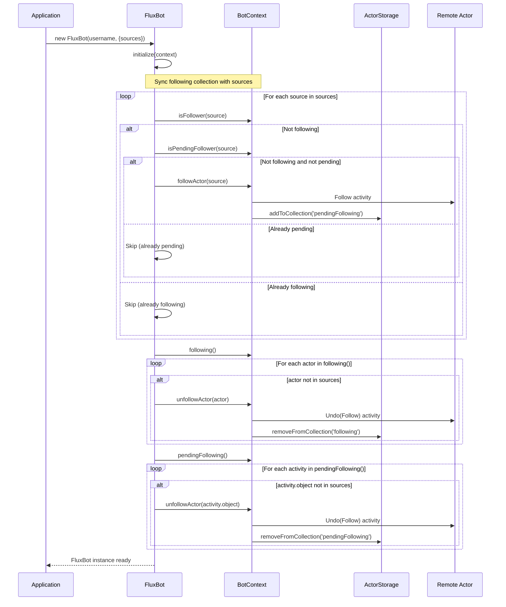
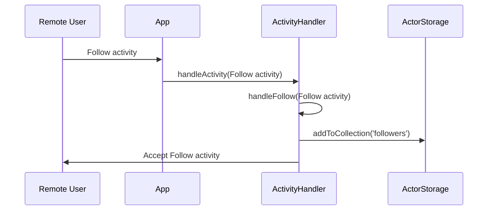
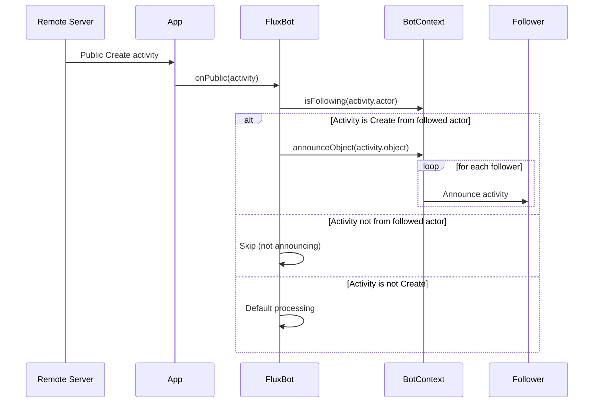

# Sequence Diagrams

This document describes the runtime behavior of flux.pub through sequence diagrams.

## Initialization Sequence

When a FluxBot is created with a list of source actors:

## Follow Activity Handling

When someone follows the FluxBot:

## Public Activity Aggregation

When a public Create activity arrives from a followed actor:

